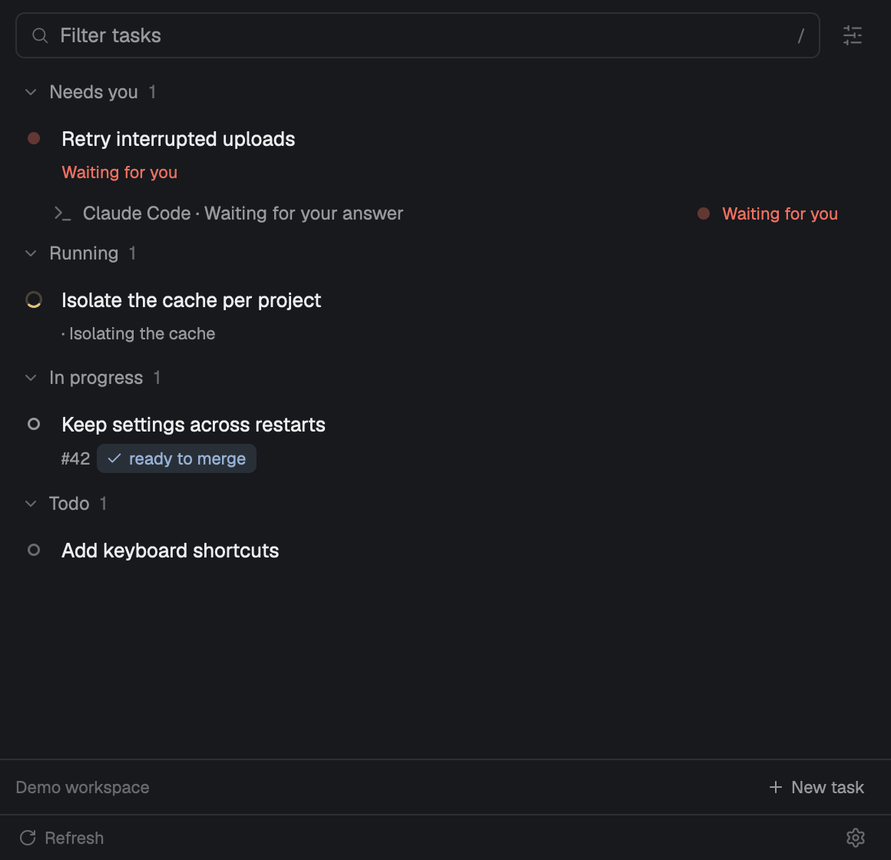

# Berbr for Herdr

**Keep each coding task together: agents, worktrees, notes and merge requests.**

Berbr is a native Herdr panel for developers working on several coding tasks
with Claude Code or Codex. See which agent needs you and pick up where you left off.



This **macOS public preview** supports local tasks, GitHub Issues/PRs, Jira/GitLab,
project-scoped task and MR views, and a portable agent skill.

## Views and task context

Native GPUI mod in the right panel, alongside Files and Changes. The panel
has one search row with a **Filters** button. Its popover chooses **Tasks / MR**,
one or more projects, and whether completed work is shown. The selected project
scope is saved. Project snapshots load independently, at most two at a time;
failures retain cached rows and identify the affected project. Rows are labelled
with their project, and actions keep the source project's context even when task
IDs coincide. New task stays below the list; its form selects the creation project.
Refresh and Settings are in the footer.
Tasks shows task status and agents needing
attention. Click a task to select its Herdr space; the separate `⋯` button
opens its note and related tickets, merge requests, worktrees and agents.
Tasks without a live space open details with an explicit Start work action.

MR shows a flat list of your GitLab merge requests and GitHub pull requests across the selected projects' configured
repositories, including MRs without a task or local checkout. Each MR appears once,
with its repository, associated tasks, CI, approvals, unresolved discussions,
draft/conflict and merge readiness. Click or press Enter to open it in the browser;
right-click offers the usual link/branch actions. Search matches titles, branches,
repositories and task names. The last Tasks / MR choice is saved for each project;
switching views keeps their searches and selections separate.

Only open MRs appear initially. **Show completed** in Filters (or `d`) includes merged and closed
MRs already present in the current snapshot, rather than loading a full history.
The additive `merge_requests` snapshot field contains every fetched MR with its
full title, repository, ticket keys and task associations, independently of tree
presentation. Older backends fall back to the MRs present in the task tree.
Unavailable CI is shown as unknown. Cached results and source warnings follow the
same refresh behavior as Tasks. `berbr.tasks` and `berbr.mrs` can also be bound as
Herdr commands. GitHub PRs use the configured GitHub integration.

Expanded tasks also show **Artifacts**, a shared tree of any files and folders.
Folders load on expansion; only visible directories refresh every five seconds.
The header can refresh them manually or open the root folder in Finder.
Markdown uses Berbr's note viewer/editor, other files their default app, and
scripts/executables the text editor. Symlinks are revealed rather than traversed.
Artifacts live under Berbr's home, outside worktrees and task-note directories,
and remain available for closed tasks.

The existing Rust model owns Jira, GitLab, notes, worktrees and Claude/Codex
history. The mod consumes `berbr app-snapshot` JSON. It launches the backend through
login/interactive zsh to inherit the same credentials as the terminal TUI;
arguments are passed literally, without interpolating them into shell code. Snapshots never update
task notes; cached startup is followed by an online refresh. Local refreshes
run every 30 seconds, online ones every five minutes. Errors and cached
service results are shown in the panel. Live agent attention comes from the
app. Remote machines are excluded from this first local-project adapter.

## Install or update

Download this repository's macOS release archive for your architecture:
`aarch64-apple-darwin` (Apple Silicon) or `x86_64-apple-darwin` (Intel).
Compare its SHA-256 with the accompanying checksum, unpack, then run:

```sh
python3 install.py --activate
```

Archives include the backend; Rust is not needed. Requires Herdr, Python 3, Git
and your chosen installed/authenticated agent CLI. Tested with Herdr App 0.1.14.
See the latest prerelease on the repository’s Releases page.

Updates use the same command. The installer validates in an isolated home, backs
up the installed mod/backend, then replaces them together. Layouts, keys and
project config are preserved. A new installation docks on the right.
`--activate` uses Herdr’s overlay toggle: it opens Berbr when closed and closes
it if already open. Otherwise use the command palette.
No new layout or replacement tab bar is installed.

Add `~/.config/herdr-app/mods/berbr` to PATH for terminal use.
`HERDR_APP_HOME` selects another Herdr home.

## First task

**Connect repository** asks for a local Git repository and Codex or Claude Code.
Enable **Connect GitHub Issues & PRs** to use a github.com origin; authenticate
with `gh auth login` first. It writes project config, then offers **New task**.
No task or agent is created merely by connecting. Existing configs load as before.

```sh
berbr init --repo /path/to/repository --agent codex
berbr doctor
berbr --agent codex start "Improve upload retries" --name upload-retries
```

For CLI/TUI use with the desktop backend, set `BERBR_BACKEND=herdr-app`.
Local tasks need no Jira or GitLab. Configure integrations later using the main
README. Explicit config paths and vault-backed notes remain supported.
An invalid existing config is reported and preserved.

The mod runs programs and reads/writes task notes, repository state and relevant
agent history. Configured integrations access the network. Workflow actions can
create worktrees/agents and close tasks/tickets through their normal confirmation.
No credentials or personal config are shipped.

## Source install

```sh
cargo build --release --locked
python3 scripts/install-herdr-app.py --activate
```

Existing personal Berbr layouts keep working. The public installer updates
`berbr` only; it does not install or change the old `tabs-berbr` source.

## Validation and packaging

```sh
env -u BERBR_BACKEND cargo test --locked
node --test --test-concurrency=1 herdr-app/berbr/tests/*.test.mjs
python3 -m unittest discover -s scripts/tests
herdr-app check herdr-app/berbr
python3 scripts/preview-herdr-app.py
python3 scripts/package-herdr-app.py --binary target/release/berbr --target aarch64-apple-darwin --version v0.2.0-preview.1
python3 scripts/package-herdr-app.py --gallery --version v0.2.0-preview.1
```

The preview opens a separate native window with a temporary home, synthetic
data and a private core socket. External actions are disabled. It closes only
its own app/core. `--setup --output /tmp/berbr-setup.png` captures onboarding.

Archives and checksums go to `dist/`. `dist/berbr-gallery/` has
`mods/berbr/`, `RECIPE.md`, `preview.png`, an installer and release metadata,
without a `layouts/` folder. This source-only folder still needs a compiled
backend. The portable `skills/berbr` and `skills/done` skills are included in the package.

The **macOS preview** workflow builds both architectures on manual dispatch.
Cold-model performance budgets for 400 tasks are 15 ms on Apple Silicon and
50 ms on Intel (the native CI baseline is 41 ms); idle updates retain a 25 ms
budget on both. CI logs report the measured times.
Publishing a GitHub Release triggers builds and attaches archives/checksums.
Adding the workflow alone publishes nothing.

## Publishing

The gallery source is generated under `gallery/berbr/`. The repository topic
`herdr-mod` enables automatic discovery by [Herdr](https://herdr.dev/gallery/?type=mods).
Community images are screened separately. Release archives include the matching
backend and MIT license. GitHub Enterprise and Linux are not supported in this preview.
