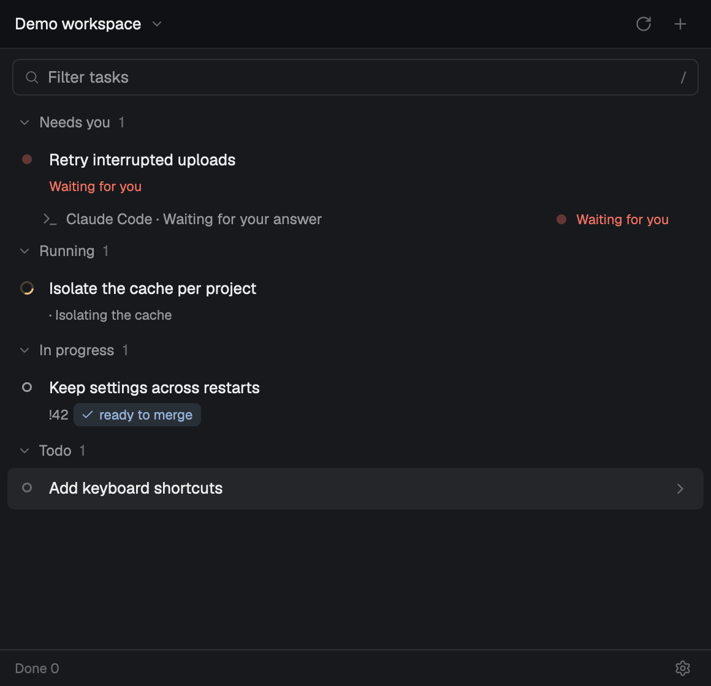

# Berbr

Keep each coding task together in Herdr: its agents, worktrees, notes and merge requests. See who needs an answer and pick up where you left off. Berbr is a native panel that follows the person's theme.

## What you see

A panel on the right, initially 420 logical pixels wide. A project selector, refresh and New task sit at the top; search follows. Tasks are grouped by attention and activity. Each task shows its name and status; expansion reveals its worktrees, agents, tickets and merge requests. A footer opens settings and completed tasks. Empty configuration opens a Connect repository form instead of an error.

The surface, text, borders and status colors come from the current Herdr theme. Use 12–13 px text, a 40 px header, compact rows and wrapping action strips. Long labels truncate with tooltips; descriptions and errors wrap. Keep search and footer visible while the task list scrolls.

## How it behaves

- A task with a live space goes to it. Its separate disclosure control opens details without switching away. Tasks with no space offer Start work explicitly.
- Working, blocked, done and idle agents use the corresponding Herdr state. Blocked agents show their available questions or permission choices; clicking an agent returns to its terminal.
- Worktree actions resume or start an agent, start a review, open a terminal or inspect removal. Destructive actions show a plan before confirmation.
- New task accepts a name, branch, Jira ticket or a description to generate a name. Working and naming agents have independent settings. A task can exist as a note without an agent or worktree.
- The panel follows focus while the person works in terminals; keyboard focus in the panel preserves their selection. Search filters task context. Arrow keys move and expand, Enter opens, `/` focuses search, and Command+K jumps.
- Snapshots are read-only. Cached data loads first; local refresh is every 30 seconds and online refresh every five minutes. Errors and stale data stay visible.
- First run asks for a local Git repository, an optional project name and Codex or Claude Code. Connect creates project config; it does not create a task or start an agent. The empty task list then offers New task.

## Built from

One mod, `mods/berbr/`, with `main.js`, `model.js`, `forms.js`, `ui.js`, `log.js`, icons and `mod.json`. The manifest docks it on the right and opts into keyboard focus. There is no bundled layout or replacement tab bar; add it to the person's existing window.

Use `gpui-kit` and `gpui-base`, Herdr `theme`, `spaces`, `agents`, `panes`, `focused`, `shared`, `nextCommand`, `run`, `hc`, and overlays. Native forms use Input, Textarea and TextView. Relative modules hold the model, UI helpers and note forms. Follow the installed `herdr.d.ts` and `gpui-kit.d.ts`.

The Rust `berbr` backend is required at `<appHome>/mods/berbr/berbr`; an embedding layout may supply a `binary` prop. The mod runs argv through `zsh -lic 'exec "$@"'`, selects `BERBR_BACKEND=herdr-app`, and clears inherited caller IDs before passing the current context. It reads `berbr app-snapshot [--cached]` JSON. Setup runs `berbr init --repo <path> --agent codex|claude`; `berbr doctor` reports setup and dependency checks.

Use the matching macOS release archive: unpack it and run `python3 install.py --activate`. Updating uses the same command. The installer validates the mod in a temporary home, saves the installed mod/backend under `backups/`, then replaces them together. It preserves layouts, keys and project configuration. Source users can build with `cargo build --release --locked` and run `python3 scripts/install-herdr-app.py --activate`.

## Watch out

- macOS preview. It uses `zsh`, `open` and `pbcopy`; other platforms are not verified. Git, Herdr/herdr-core and an installed, authenticated Codex or Claude CLI are needed to start agent work. Python 3 runs the installer; Rust is needed only for a source build.
- The mod runs programs and reads/writes files outside its own folder. The backend reads repository state, task notes and relevant agent history; configured Jira/GitLab connections access the network. Explicit workflow actions can create worktrees and agents or close tasks/tickets. Disclose these capabilities before installation.
- No config or credentials are shipped. Config is normally `~/.berbr/config.toml`; task notes live under `~/.berbr/projects/`. Explicit config overrides and existing configurations are preserved. A vault setup remains supported.
- UI logging stays under the Herdr home. Backend logs are available with `berbr logs`; remote service failures must not look like empty successful results.
- Never overwrite another mod with the same name silently. The included installer treats an existing `berbr` as an update and backs it up. For an unrelated name collision, adapt the mod name, its asset paths and backend path before copying it.
- GitHub support, task/MR/PR views and the distributable agent skill are release dependencies tracked separately. Describe only integrated, tested features in a published gallery card. This recipe describes the current build.
- The gallery folder contains sources. A backend compiled for the person's architecture must accompany it; copying the JavaScript alone is insufficient.

## Done when

- `cargo test --locked` and `node --test --test-concurrency=1 herdr-app/berbr/tests/*.test.mjs` pass.
- `herdr-app check <mod folder>` passes against the installed Herdr version.
- In an isolated home with no config, the connection form shows; connecting a local repository reaches the task list and New task works.
- Existing config and layouts survive install/update, and a failed validation leaves the installed version intact.
- Task expansion, agent attention, note editing, New task, settings and keyboard navigation work with representative data.
- The gallery preview uses synthetic data. Release archives include the matching executable, recipe, preview and installer.
